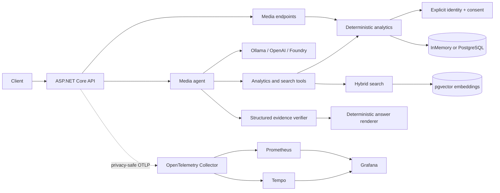

# Media Intelligence Agent

A portfolio-scale OTT and AdTech reference implementation for deterministic audience analytics with an evidence-verified AI interface. It combines consent-aware cross-device measurement, campaign reach and frequency, PostgreSQL/pgvector discovery, interchangeable LLM providers, and privacy-safe OpenTelemetry instrumentation.

All included media, campaign, device, audience, and consent records are synthetic.

## What it demonstrates

- Deterministic content analytics: viewing sessions, completion rate, and ad-exposure rate.
- Consent-aware identity resolution using explicit pseudonymous device-to-audience links only. Unknown, ambiguous, denied, and missing-consent identities are excluded by default.
- Campaign measurement for impressions, eligible impressions, deduplicated reach, average frequency, and eligible coverage.
- PostgreSQL 17 persistence with idempotent fixtures and an InMemory default for lightweight local use.
- pgvector semantic media discovery combined with exact title/tag signals and explicit, opt-in indexing.
- Optional Kafka-compatible Redpanda ingestion with versioned events, durable idempotency, replay safety, and DLQ handling.
- One tool-calling agent supporting Ollama, OpenAI, and Microsoft Foundry through configuration.
- Versioned structured model output, deterministic evidence binding, privacy checks, and fail-closed rendering.
- Optional Grafana, Tempo, Prometheus, and OpenTelemetry Collector services.
- Offline tests and a deterministic local benchmark stub that never calls a paid model.

## Architecture



The model chooses tools and proposes typed claims; it does not calculate authoritative metrics. Tool results retain entity and metric provenance, and only schema-valid, evidence-supported claims reach the existing `answer` string. Invalid structured output is retried once and then returns a clear verification failure.

See [Architecture](docs/architecture.md) and [Engineering decisions](docs/engineering-decisions.md).

## Quick start

Requirements: Docker Desktop with Compose. Copy the development environment template and choose a local-only database password:

```powershell
Copy-Item .env.example .env
# Edit POSTGRES_PASSWORD in .env
docker compose up --build -d
docker compose ps
Invoke-RestMethod http://localhost:5215/health
Invoke-RestMethod http://localhost:5215/api/media
```

The expected health response is `Healthy`. The default Compose stack starts PostgreSQL, runs migrations and deterministic seeding once, then starts the non-root API. PostgreSQL is not published to the host. Ollama is deliberately not part of the default stack.

For a reproducible five-minute tour—including campaign analytics, identity checks, pgvector indexing, the deterministic structured-agent path, and optional Grafana—follow [docs/demo.md](docs/demo.md).

To run directly with the lightweight default instead:

```powershell
dotnet restore MediaIntelligence.slnx
dotnet run --project src/MediaIntelligence.Api
```

This uses `Storage:Provider=InMemory` and Ollama `qwen3:4b` at `http://localhost:11434` unless configuration overrides them.

## API and agent

Stable public contracts:

```http
GET  /health
GET  /api/media
GET  /api/media/{contentId}/analytics
POST /api/agent/ask
Content-Type: application/json

{"question":"Compare City Stories Launch and Desert Heroes Encore."}
```

The agent can call:

| Tool | Purpose |
| --- | --- |
| `get_content_analytics` | Single-title viewing analytics |
| `compare_content_performance` | Cross-title viewing comparison |
| `get_audience_identity_metrics` | Consent-aware reach and frequency for a title |
| `get_campaign_performance` | Campaign metrics with optional UTC bounds |
| `compare_campaign_performance` | Attributed campaign metrics and deterministic deltas |
| `search_media_content` | Aggregate-safe hybrid title/tag/vector discovery |

Campaign and identity tools return aggregate evidence only; raw device IDs, audience IDs, and mappings are never provided to the model. Metric definitions are documented in [campaign metrics](docs/campaign-metrics.md) and [audience identity metrics](docs/audience-identity-metrics.md).

## LLM providers

`Llm:Provider` accepts `Ollama` (default), `OpenAI`, or `Foundry`. Provider-specific options are validated at startup, there is no silent fallback, and credentials belong in environment variables or .NET User Secrets—not tracked settings files.

```powershell
# Ollama
$env:Llm__Provider = "Ollama"
$env:Llm__Ollama__Endpoint = "http://localhost:11434"
$env:Llm__Ollama__Model = "qwen3:4b"

# OpenAI
$env:Llm__Provider = "OpenAI"
$env:Llm__OpenAI__ApiKey = "<secret>"
$env:Llm__OpenAI__Model = "<tool-capable-model>"

# Microsoft Foundry / Azure OpenAI v1 endpoint
$env:Llm__Provider = "Foundry"
$env:Llm__Foundry__Endpoint = "https://<resource>.openai.azure.com/openai/v1"
$env:Llm__Foundry__Deployment = "<deployment>"
# Use Azure CLI / managed identity, or Llm__Foundry__ApiKey locally.
```

Configuration details, Azure prerequisites, and truthful live-validation status are in [Architecture](docs/architecture.md) and [Evaluation](docs/evaluation.md). Paid cloud calls are never made by tests.

## Privacy and reliability

- Identity matching is explicit and deterministic—never inferred from IP address, location, fingerprinting, or probability.
- Consent is default-deny. Missing consent is not consent.
- `AdShown` contributes at most one eligible impression per viewing event; campaign impressions are separate first-class events.
- Strict response schema v1 rejects unknown versions, fields, invalid units, unsupported numbers, bad attribution, incorrect comparison direction, and excessive size/depth.
- Evidence references bind every numerical claim to tool executions; deltas are recomputed from source metrics.
- Full prompts, model responses, credentials, and pseudonymous identifiers are excluded from normal logs and telemetry.
- Local rejected-draft diagnostics are opt-in, Development-only, redacted, short-lived, and written outside the repository.

## Storage and semantic search

`Storage:Provider` is `InMemory` by default and `PostgreSQL` in Compose. Production startup never auto-migrates. The explicit `migrate` service applies checked-in migrations and runs idempotent synthetic seeding before the API starts.

Media embeddings store content ID, model, dimension, content hash/version, timestamp, and a pgvector value. Indexing is explicit:

```powershell
docker compose --profile search run --rm index-media
```

The built-in deterministic embedding provider exists for offline tests and local demonstrations; production indexing must select and govern an appropriate embedding provider. Stale, missing, or incompatible embeddings are excluded from vector scoring. See [Semantic search](docs/semantic-search.md).

## Testing

```powershell
dotnet test MediaIntelligence.slnx -c Release
dotnet build MediaIntelligence.slnx -c Release --no-restore

# Real PostgreSQL/pgvector tests; Docker required
docker compose --profile test run --rm integration-tests

# NuGet vulnerability audit
dotnet list MediaIntelligence.slnx package --vulnerable --include-transitive
```

The normal test suite is offline and uses no Ollama, OpenAI, Foundry, API keys, or EF InMemory substitute. PostgreSQL parity tests run only when their real connection string is supplied; the Compose test service provides it.

## Observability

The API emits privacy-safe traces and metrics for request, agent, LLM round, tool, evidence, and repository timing. Start the optional stack explicitly:

```powershell
docker compose -f compose.yaml -f compose.observability.yaml `
  --profile observability up -d --build
```

Grafana is available at [http://localhost:3000](http://localhost:3000) with provisioned Prometheus/Tempo data sources and a Media Intelligence dashboard. The dashboard covers API rate and p50/p95/p99 latency, agent and provider latency, tool duration/errors, and evidence failures. See [Observability](docs/observability.md).

## Measured local performance

These are engineering measurements, not production capacity claims. On a Windows 11 laptop (Intel Core i7-1255U, Docker Desktop 29.8.1), each row used four VUs, a three-second warm-up, and a ten-second measured window with the deterministic local chat stub:

| Workload | Storage | Throughput | p50 | p95 | p99 | Errors |
| --- | --- | ---: | ---: | ---: | ---: | ---: |
| API workflow, 3 requests | InMemory | 2,342.9 workflows/s | 1.188 ms | 2.704 ms | 3.705 ms | 0% |
| API workflow, 3 requests | PostgreSQL | 481.6 workflows/s | 6.742 ms | 14.056 ms | 20.657 ms | 0% |
| Agent success | InMemory | 2,094.0 requests/s | 1.629 ms | 2.609 ms | 3.206 ms | 0% |
| Agent success | PostgreSQL | 414.3 requests/s | 9.180 ms | 11.933 ms | 13.522 ms | 0% |

The stub exercises the real SDK, tool execution, structured validation, evidence review, and rendering, but has no token-generation or remote-network latency. A separate OTel capture reported a 45.24 ms agent p95; it combined storage variants in a different sequential sample and used cumulative histogram interpolation, so it is not comparable to the per-variant k6 p95. The investigation and complete results—including retry/failure scenarios—are in [Performance](docs/performance.md).

## Repository map

```text
src/MediaIntelligence.Api/       HTTP API, DI, provider and telemetry setup
src/MediaIntelligence.Core/      Domain, analytics, persistence, search, agent
tests/MediaIntelligence.Tests/   Offline and opt-in PostgreSQL tests
benchmarks/                      Pinned k6 workload
observability/                   Collector, Prometheus, Tempo, Grafana config
docs/                            Design, evaluation, operations, demo
```

Key references: [Demo](docs/demo.md) · [Architecture](docs/architecture.md) · [Architecture evolution](docs/architecture-evolution.md) · [Scalability model](docs/scalability.md) · [Engineering decisions](docs/engineering-decisions.md) · [Evaluation](docs/evaluation.md) · [Performance](docs/performance.md) · [Semantic search](docs/semantic-search.md) · [Observability](docs/observability.md)

Optional streaming: [Kafka-compatible event pipeline](docs/streaming.md) and [scalability measurements](docs/streaming-performance.md). They use a separate Compose override and do not change default startup.

## Current limitations

- The dataset is small, synthetic, and intentionally non-representative of production traffic.
- No probabilistic identity matching, general-purpose write API, authorization layer, or production secret store is included.
- Embedding refresh is an explicit batch command; no scheduler or paid embedding integration is included.
- The default Compose stack does not run an LLM. Configure an existing Ollama/OpenAI/Foundry provider before conversational use, or use the Development-only deterministic benchmark profile.
- Cloud-provider behavior and latency are not covered by offline tests. Earlier Foundry identity verification succeeded live; campaign tools executed live, while campaign evidence initially failed. Exact rejected drafts were reproduced offline and fixed, but the final campaign fixes have not been revalidated by another paid cloud request.
- Benchmark numbers are local short-run measurements and must not be treated as SLOs or capacity guidance.
