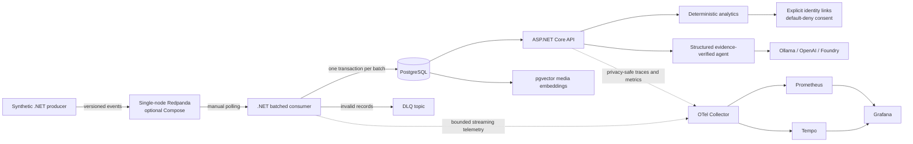
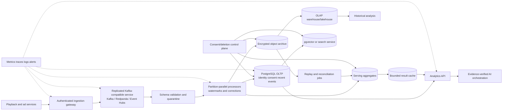

# Architecture evolution

This document separates the architecture implemented in this repository from a possible production evolution. Proposed components and targets are not deployed, benchmarked, or claimed as complete.

## Current implemented architecture

The current consumer validates strict v1 envelopes, keeps batches bounded by size/time, writes valid domain rows and the ingestion ledger transactionally, sends failures to the DLQ, and commits source offsets only after durable processing. `(Topic, EventId)` makes source replay idempotent. PostgreSQL directly backs HTTP analytics, identity/consent lookup, campaign metrics, and pgvector search.

Current constraints include one development broker node, replication factor one, synthetic fixtures, no production retention, no schema registry, no materialized streaming aggregates, no cache, no OLAP/object archive, no deletion orchestrator, and no alerting.

## Proposed production direction

This is a direction, not a required end state. Each component should be introduced only when measurements or operational requirements justify its cost.

## Ingestion, acknowledgement, and replay

Producers should use stable event IDs, UTC event time, schema version, deterministic partition key, idempotent production, and `acks=all`. Acknowledgement means the broker accepted the record under its configured replication policy; it does not mean PostgreSQL or an aggregate is current.

Consumers should retain the implemented ordering rule: persist a batch transactionally, complete required quarantine/DLQ work, then commit the highest contiguous next offset per owned partition. A crash before offset commit replays durable rows as duplicates. A crash before database commit rolls back the batch. Rebalances must stop work for revoked partitions or allow uncertain work to replay under the new owner.

Production replay needs:

- retention long enough for the largest credible outage and controlled backfill;
- immutable archive for rebuilds beyond broker retention;
- separate consumer groups for serving, archive, and derived products;
- replay rate limits so recovery cannot starve live traffic;
- deterministic aggregate rebuild and comparison against serving totals;
- audited operator tooling for offset reset, quarantine release, and correction.

The implemented DLQ can contain the original synthetic payload. Production quarantine should minimize payloads, encrypt access, restrict retention, and avoid becoming an ungoverned identity store.

## Event time, watermarks, and corrections

Current analytics persist UTC event time but do not implement watermarks or late-event policy. A production design should distinguish:

- event time: when viewing/exposure occurred;
- ingestion time: when the broker accepted it;
- processing time: when a consumer committed it;
- queryable time: when serving aggregates exposed it.

A proposed event-time processor can maintain a watermark per topic/partition based on observed event time minus an allowed-lateness interval. For example, a five-minute allowance is a policy hypothesis, not an implemented value. Events before the watermark remain accepted into immutable history but may require a correction path instead of mutating a closed aggregate silently.

Corrections should be versioned/upserted with source provenance. APIs should expose an `asOf`/freshness timestamp where decisions depend on completeness. Daily reconciliation should recompute aggregates from retained source events and emit discrepancies. Campaign date boundaries remain half-open UTC intervals, matching the current deterministic implementation.

## Schema evolution

The current topic and envelope are versioned `v1`, and the decoder rejects unknown fields and unsupported versions. At production scale:

1. Register JSON Schema, Avro, or Protobuf contracts with compatibility policy.
2. Permit additive compatible changes only after old/new consumer tests.
3. Use a new topic or explicit major version for breaking changes.
4. Dual-read or dual-write during migration with deterministic parity checks.
5. Retain original schema/version in archive and DLQ metadata.
6. Prohibit identity fields not approved by the privacy model.

Schema validation belongs before business persistence, while semantic validation such as campaign/content integrity remains deterministic domain logic.

## Identity, consent, privacy, and deletion

The implemented resolver accepts only explicit, unambiguous pseudonymous device-to-audience links with granted consent. Unknown, conflicting, denied, and missing-consent records are excluded and counted. There is no fingerprinting, IP/location match, or probabilistic graph. LLM tools and telemetry receive aggregates, never raw device/audience IDs.

Production evolution should preserve that fail-closed rule and add a privacy control plane:

- consent changes are versioned with effective UTC time and policy purpose;
- eligibility is evaluated using the consent state applicable to the event/use;
- revocation invalidates serving aggregates and caches within a defined SLA;
- deletion requests resolve approved pseudonymous keys without exposing them to operators broadly;
- tombstones/correction events propagate to recent OLTP, aggregates, vector/search metadata, caches, archive indexes, and downstream products;
- immutable backups/archive follow documented cryptographic erasure or expiry procedures;
- completion is auditable without logging raw identifiers.

Deleting identity links alone is insufficient if derived reach/frequency or exported records remain. Conversely, destructive removal can make historical financial reporting irreproducible. Policy must define deletion, anonymization, legal hold, and aggregate-retention behavior explicitly. None of this workflow is currently implemented.

## OLTP, aggregates, OLAP, cache, and pgvector

PostgreSQL currently performs four roles: system-of-record persistence, idempotency, analytical reads, and vector search. The first production step is not necessarily another database: set-based writes, time partitions, tuned indexes, connection budgets, and incremental aggregate tables may be enough.

Recommended responsibility boundaries as load grows:

| Store | Proposed responsibility |
| --- | --- |
| PostgreSQL OLTP | identity/consent, campaigns, recent event detail, ledger, correction state |
| Serving aggregates | title/campaign/cohort metrics with source version and freshness |
| Cache | short-lived hot aggregate responses; consent/correction-aware invalidation |
| Object archive | encrypted immutable event history for governed replay/rebuild |
| OLAP | broad historical scans, experimentation, BI—not request-path identity resolution |
| pgvector/search | media discovery embeddings and metadata, isolated when search load competes with ingestion |

Aggregate updates must remain deterministic and attributable to source offsets/ranges. Cache keys must not contain raw audience/device identifiers, and cache invalidation must follow consent/correction updates. Approximate vector indexes require recall/latency evaluation; the current exact hybrid search and explicit embedding refresh remain the verified behavior.

## Kafka, Redpanda, and Event Hubs

| Option | Strengths | Trade-offs / validation needed |
| --- | --- | --- |
| Apache Kafka | Broad ecosystem, mature operational semantics, portable protocol | Cluster operations, upgrades, storage, security, and capacity remain the operator's responsibility unless managed |
| Redpanda | Kafka-compatible client path; simple local experience; integrated implementation here | Production compatibility, tiered storage, operational tooling, and failure behavior must be validated for the chosen version/service |
| Azure Event Hubs Kafka endpoint | Managed Azure integration, identity/network controls, reduced broker operations | Kafka feature differences, throughput units/partitions, retention, quotas, authentication, cost, and client behavior need explicit tests |

The application uses the Confluent Kafka client and no Redpanda-specific data API. That improves portability but does not prove equivalent operational semantics. Selection should follow failure tests, regional availability, compliance, team skills, and total cost—not local benchmark throughput.

## Objectives, RPO, and RTO

The proposed targets are:

- event-to-queryable freshness p95 below 5 seconds;
- deterministic campaign API p95 below 200 ms;
- single-component recovery time objective below 15 minutes;
- near-zero loss for acknowledged events.

They are unvalidated design objectives. AI latency is measured separately by provider/model, including tool rounds, correction retries, and evidence verification.

RPO depends on failure scope:

- consumer/API loss: target zero acknowledged-event loss through broker replay;
- PostgreSQL primary loss: bounded by synchronous/managed replication and verified backups;
- broker quorum/region loss: bounded by replication and cross-region/archive policy;
- privacy or operator error: requires point-in-time recovery plus correction replay, not merely infrastructure restart.

“Near-zero” must become a numerical error budget before production approval. RTO measurement ends only when service is healthy, backlog is draining within budget, and correctness reconciliation passes—not when a process merely restarts.

## Monitoring and failure injection

Keep telemetry low-cardinality. Useful production signals include:

- ingress/processed rates, consumer lag, oldest event age, and event-to-queryable freshness;
- batch fill ratio, transaction rate/duration, retries, offset-commit failures, duplicates, and DLQ rate;
- PostgreSQL CPU, IOPS, WAL, locks, connections, vacuum, bloat, replica lag, and query p95/p99;
- aggregate reconciliation differences and correction backlog;
- consent exclusion rates by bounded reason, never identifier;
- API rate/errors/p50/p95/p99 and cache hit/staleness;
- provider-specific AI/tool/evidence latency and fail-closed response count.

Alerting is proposed, not implemented. Alerts should combine symptom and budget—for example oldest-event age plus growing lag—rather than page on every retry.

Regular failure injection should cover consumer termination mid-batch, rebalance, broker node loss, PostgreSQL failover/outage, slow disks, connection exhaustion, duplicate storms, poison payloads, hot keys, late/out-of-order events, schema incompatibility, cache staleness, consent revocation, deletion propagation, archive replay, and telemetry outage. Every exercise should verify durable totals and privacy invariants, not only availability.

## Phased roadmap

### Phase 0 — verified repository baseline

Retain current deterministic metrics, evidence boundary, default-deny consent, transactional batching, replay tests, PostgreSQL/pgvector, and optional OTel/Grafana. Expand sustained tests and establish reproducible dashboards.

### Phase 1 — production-ready single region

Choose a managed/operated replicated broker and PostgreSQL service; add TLS/identity, secrets management, schema registry, backups/PITR, table partitioning, connection pooling, alerts, runbooks, and production-like load/failure tests. Define numerical SLO/error budgets and retention/privacy policy.

### Phase 2 — serving efficiency and governed replay

Add incremental aggregate tables, reconciliation, freshness metadata, bounded cache, encrypted object archive, replay tooling, event-time watermarks, late/correction handling, and consent/deletion propagation. Validate p95 freshness and campaign API targets.

### Phase 3 — analytical separation

Move wide historical scans to OLAP/lakehouse, isolate search/vector resources if measured contention warrants it, and introduce read replicas or regional serving where correctness semantics permit.

### Phase 4 — regional resilience

Only after single-region recovery is proven: design cross-region broker/archive/database recovery, test failover and privacy propagation, document conflict ownership, and validate RPO/RTO under regional loss.

## Five-minute architecture walkthrough

1. **Start with trust boundaries (45 seconds):** deterministic C# services own metrics and identity decisions; the LLM only orchestrates tools and must pass structured evidence verification. Consent is explicit and default-deny.
2. **Show the current data path (45 seconds):** versioned synthetic events enter optional Redpanda, the bounded .NET consumer validates and transactionally writes domain plus idempotency ledger rows, then commits offsets. PostgreSQL serves the same HTTP analytics.
3. **Explain measured bottleneck (45 seconds):** local Step 18C batching moved mean drain rate from 92.1 to 309.8 events/s and reduced roughly 1,500 transactions to 15–16, but those laptop results are not extrapolated to production.
4. **Introduce the hypothetical scale (45 seconds):** 2,000 average/10,000 peak events/s yields 172.8 million events/day and exposes broker retention, hot-key, PostgreSQL/WAL, and recovery constraints.
5. **Walk the evolution diagram (60 seconds):** replicated broker, governed archive/replay, PostgreSQL OLTP, deterministic serving aggregates/cache, OLAP separation, and optional search isolation. Each addition follows measurement.
6. **Cover correctness and privacy (30 seconds):** stable IDs, replay, watermarks, late corrections, consent-at-use, deletion propagation, aggregate reconciliation, and no identity values in AI or telemetry.
7. **Close with objectives and proof plan (30 seconds):** proposed freshness p95 <5 s, campaign API p95 <200 ms, component RTO <15 min, and near-zero acknowledged-event loss—validated through sustained load and failure injection, with AI latency reported separately.
