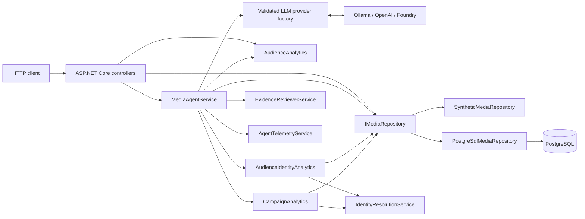
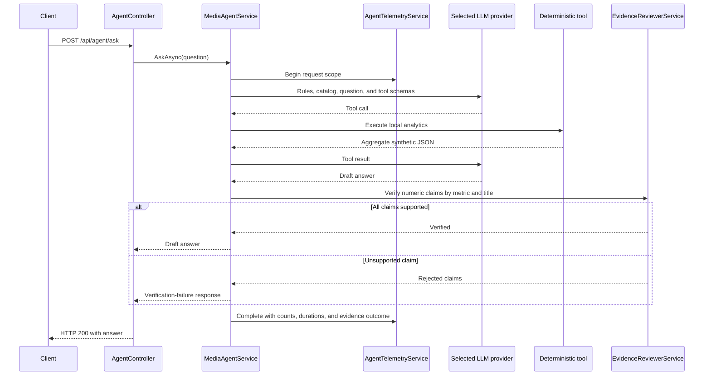

# Architecture

The solution is intentionally small and local-first. ASP.NET Core hosts the
HTTP API, deterministic services calculate every metric, and a single
configuration-selected LLM supplies only natural-language orchestration and
summarization. Ollama remains the default.

## Components

`MediaIntelligence.Api` is the composition root. `MediaIntelligence.Core`
contains domain models, interfaces, synthetic data, deterministic analytics,
agent orchestration, evidence review, and telemetry.

## Storage selection and relational mapping

The composition root selects one `IMediaRepository` implementation from
`Storage:Provider`. `InMemory` is the default and retains the existing
singleton synthetic repository. `PostgreSQL` registers a scoped EF Core
`MediaIntelligenceDbContext` and `PostgreSqlMediaRepository`; analytics and the
agent continue to depend only on `IMediaRepository`.

The PostgreSQL schema stores media content, viewing events, campaigns, ad
impressions, pseudonymous audiences, explicit device-to-audience association
pairs, and consent records. Device IDs remain opaque values and are never
joined to inferred IP, location, or fingerprint data. A composite association
key prevents duplicate pairs but deliberately does not make `DeviceId` unique,
so conflicting explicit mappings remain representable and default-denied by
the unchanged identity resolver. Consent has one row per audience; absence of
that row retains default-deny semantics.

Foreign keys enforce content ownership and campaign/content consistency.
Campaign names and content titles are unique. PostgreSQL `timestamp with time
zone` stores viewing, campaign, and impression instants; campaign ranges have a
database check constraint. Query indexes follow current repository access:

- viewing events by `(ContentId, ViewedAtUtc)`;
- ad impressions by `(CampaignId, OccurredAtUtc)` and by `ContentId`;
- campaigns by `ContentId` and unique `Name`;
- associations by `AudienceId`, while the composite primary key begins with
  `DeviceId` for identity lookup;
- consent and audience lookups use their primary keys.

The initial migration is checked in. Production startup never applies it.
Migration and deterministic seed execution are available only through explicit
deployment commands or the opt-in Development initializer. The seed uses
stable keys and inserts missing records without duplicating existing fixtures.

## Provider registration and authentication

The composition root binds and validates one `LlmOptions` tree at startup.
`LlmClientFactory` constructs one singleton OpenAI SDK `ChatClient`, so
`MediaAgentService` and its tool loop do not branch on providers.

| Provider | Model value | Endpoint | Authentication |
| --- | --- | --- | --- |
| Ollama | `qwen3:4b` by default | Local `/v1` compatibility endpoint | Non-secret placeholder required by the client |
| OpenAI | `gpt-4.1-mini` by default | Official `api.openai.com/v1` | API key from environment or User Secrets |
| Foundry | Azure deployment name | Azure model inference `/openai/v1/` | `DefaultAzureCredential` or API key |

Foundry endpoint validation is deliberately narrow. It accepts Azure OpenAI or
Foundry resource inference hosts and rejects native project/agent endpoint
shapes because those APIs are not interchangeable with Chat Completions.
Provider, model, endpoint, authentication mode, and timeout are configuration;
credentials are never placed in checked-in settings or telemetry.

## Agent request flow

The loop is bounded to five LLM rounds. Evidence review is local and does not
trigger another model request.

## Deterministic analytics

`AudienceAnalytics` calculates completion rate and advertising-exposure rate
from viewing events. `compare_content_performance` applies those calculations
to the three synthetic titles and orders them by completion rate.

No metric is calculated by the model. The model can only request deterministic
tool output and summarize it.

## Identity, consent, reach, and frequency

`SyntheticMediaRepository` contains opaque synthetic `DeviceId` and
`AudienceId` values, explicit associations, and explicit consent records.
`IdentityResolutionService` resolves a device only when:

1. The device has an explicit association.
2. The association identifies exactly one audience.
3. That audience has exactly one explicit granted consent status.

Anything else is excluded by default. `AudienceIdentityAnalytics` considers
only events where `AdShown` is true. Each such event contributes at most one
impression. Eligible impressions are deduplicated by pseudonymous audience for
reach; frequency is eligible impressions divided by reach.

The agent tool exposes only aggregate metrics, coverage, exclusions,
definitions, and limitations. Device and audience identifiers never enter the
LLM tool result.

## Campaign-aware measurement

Campaigns and ad impressions form a separate synthetic domain from viewing
events. `CampaignAnalytics` filters impressions by campaign/content and a
half-open UTC interval, then delegates every identity decision to the unchanged
`IdentityResolutionService`. It calculates total and eligible impressions,
deduplicated eligible reach, average frequency, coverage, and aggregate
exclusions.

`get_campaign_performance` returns one campaign result;
`compare_campaign_performance` returns all campaign results. Both accept
optional UTC boundaries, reject invalid ranges, and expose no device or
audience identifiers. `EvidenceReviewerService` treats campaign names as
cohorts and keeps total impressions distinct from eligible impressions, so a
number from another campaign or metric cannot support a claim.

## Evidence boundary

`EvidenceReviewerService` parses numeric values from tool JSON and numeric
claims from the draft answer. It checks values with display-rounding tolerance
and constrains matches by recognized metric and nearby title/cohort. Unsupported
claims cause the entire model draft to be replaced before the controller
creates the public `{ "answer": ... }` response.

## Telemetry and data minimization

`AgentTelemetryService` emits structured `ILogger` events and activities under
`MediaIntelligence.Agent`. It records request ID, status, durations, LLM rounds,
tool names/counts, provider/model, and evidence outcome. It does not receive or
log prompts, model responses, tool payloads, endpoints, credentials, device
IDs, or audience IDs.

No telemetry exporter is configured. Consumers can attach an
`ActivityListener` or add an exporter later without changing domain logic.
