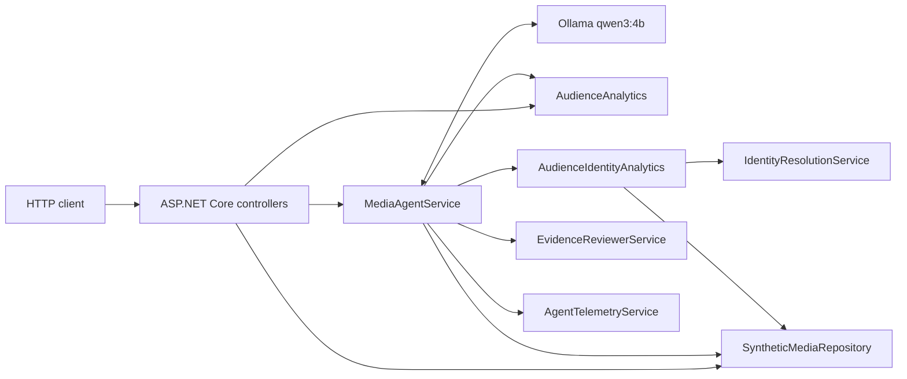
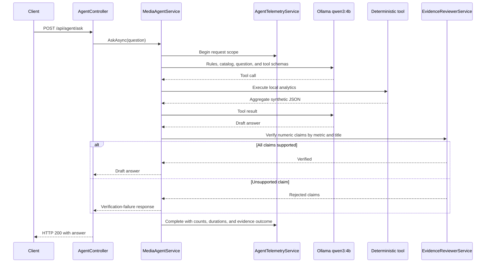

# Architecture

The solution is intentionally small and local-first. ASP.NET Core hosts the
HTTP API, deterministic services calculate every metric, and Ollama supplies
only natural-language orchestration and summarization.

## Components

`MediaIntelligence.Api` is the composition root. `MediaIntelligence.Core`
contains domain models, interfaces, synthetic data, deterministic analytics,
agent orchestration, evidence review, and telemetry.

## Agent request flow

The loop is bounded to five LLM rounds. Evidence review is local and does not
trigger another model request.

## Deterministic analytics

`AudienceAnalytics` calculates completion rate and advertising-exposure rate
from viewing events. `compare_content_performance` applies those calculations
to the three synthetic titles and orders them by completion rate.

No metric is calculated by the model. The model can only request deterministic
tool output and summarize it.

## Identity, consent, reach, and frequency

`SyntheticMediaRepository` contains opaque synthetic `DeviceId` and
`AudienceId` values, explicit associations, and explicit consent records.
`IdentityResolutionService` resolves a device only when:

1. The device has an explicit association.
2. The association identifies exactly one audience.
3. That audience has exactly one explicit granted consent status.

Anything else is excluded by default. `AudienceIdentityAnalytics` considers
only events where `AdShown` is true. Each such event contributes at most one
impression. Eligible impressions are deduplicated by pseudonymous audience for
reach; frequency is eligible impressions divided by reach.

The agent tool exposes only aggregate metrics, coverage, exclusions,
definitions, and limitations. Device and audience identifiers never enter the
LLM tool result.

## Evidence boundary

`EvidenceReviewerService` parses numeric values from tool JSON and numeric
claims from the draft answer. It checks values with display-rounding tolerance
and constrains matches by recognized metric and nearby title/cohort. Unsupported
claims cause the entire model draft to be replaced before the controller
creates the public `{ "answer": ... }` response.

## Telemetry and data minimization

`AgentTelemetryService` emits structured `ILogger` events and activities under
`MediaIntelligence.Agent`. It records request ID, status, durations, LLM rounds,
tool names/counts, and evidence outcome. It does not receive or log prompts,
model responses, tool payloads, device IDs, or audience IDs.

No telemetry exporter is configured. Consumers can attach an
`ActivityListener` or add an exporter later without changing domain logic.
