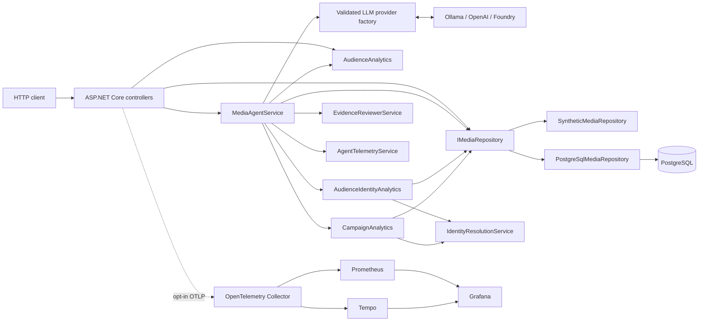
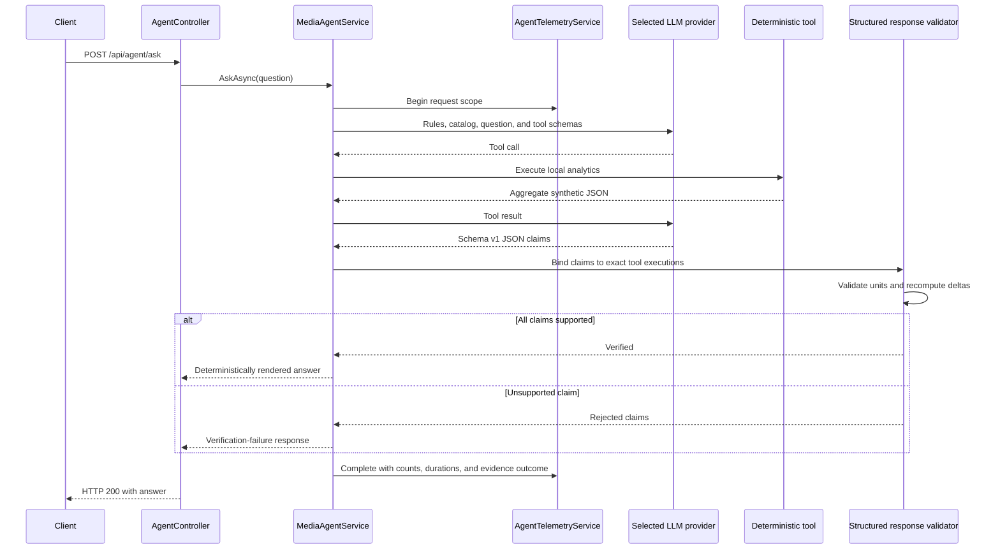

# Architecture

The solution is intentionally small and local-first. ASP.NET Core hosts the
HTTP API, deterministic services calculate every metric, and a single
configuration-selected LLM supplies only natural-language orchestration and
summarization. Ollama remains the default.

## Components

`MediaIntelligence.Api` is the composition root. `MediaIntelligence.Core`
contains domain models, interfaces, synthetic data, deterministic analytics,
agent orchestration, evidence review, and telemetry.

## Storage selection and relational mapping

The composition root selects one `IMediaRepository` implementation from
`Storage:Provider`. `InMemory` is the default and retains the existing
singleton synthetic repository. `PostgreSQL` registers a scoped EF Core
`MediaIntelligenceDbContext` and `PostgreSqlMediaRepository`; analytics and the
agent continue to depend only on `IMediaRepository`.

The PostgreSQL schema stores media content, viewing events, campaigns, ad
impressions, pseudonymous audiences, explicit device-to-audience association
pairs, and consent records. Device IDs remain opaque values and are never
joined to inferred IP, location, or fingerprint data. A composite association
key prevents duplicate pairs but deliberately does not make `DeviceId` unique,
so conflicting explicit mappings remain representable and default-denied by
the unchanged identity resolver. Consent has one row per audience; absence of
that row retains default-deny semantics.

Foreign keys enforce content ownership and campaign/content consistency.
Campaign names and content titles are unique. PostgreSQL `timestamp with time
zone` stores viewing, campaign, and impression instants; campaign ranges have a
database check constraint. Query indexes follow current repository access:

- viewing events by `(ContentId, ViewedAtUtc)`;
- ad impressions by `(CampaignId, OccurredAtUtc)` and by `ContentId`;
- campaigns by `ContentId` and unique `Name`;
- associations by `AudienceId`, while the composite primary key begins with
  `DeviceId` for identity lookup;
- consent and audience lookups use their primary keys.

The initial migration is checked in. Production startup never applies it.
Migration and deterministic seed execution use the explicit
`--migrate-and-seed` command, which refuses to run outside Development. The
seed uses stable keys and inserts missing records without duplicating existing
fixtures.

## Docker Compose startup ordering

The default Compose project runs three services: PostgreSQL, a one-shot
migration/seed container, and the API. PostgreSQL must pass `pg_isready`; the
migration container then applies the checked-in migration and idempotent seed;
the API starts only after that container exits successfully. Normal API
containers never migrate, eliminating multi-instance startup races.

PostgreSQL uses a persistent named volume and is not published to the host.
Only the API is bound, on loopback. The API health check covers its selected
storage, and Compose gates it on both database health and migration completion.
An optional test-profile container runs the real Npgsql integration test on
the private network.

The PostgreSQL image includes pgvector. `media_embedding` stores one vector per
content/model with dimension, source hash/version, and UTC refresh time. The
default stack performs no embedding work; the `search` profile exposes the
explicit Development-only indexing command after migration/seed.
No Ollama service or model download is part of the Compose project. Ollama,
OpenAI, and Foundry remain separately configured optional LLM providers.

## Optional observability pipeline

OpenTelemetry export is disabled by default. The observability Compose override
enables ASP.NET Core instrumentation plus the existing agent `ActivitySource`
and meter, then sends OTLP/gRPC to one collector. The collector exports traces
to Tempo and exposes application metrics for Prometheus to scrape. Grafana is
provisioned with both data sources and one dashboard. Prometheus exemplar
links target Tempo; Tempo trace-to-metrics queries map `service.name` to the
Prometheus `service_name` label.

The pipeline exports no logs. Span and metric attributes are deliberately
bounded and exclude request bodies, prompts, model responses, analytics tool
payloads, credentials, and pseudonymous identity values. The collector,
Prometheus, Tempo, and PostgreSQL have no host-published ports; only the API and
Grafana bind to loopback. See [observability.md](observability.md) for startup,
versions, and verification commands.

## Optional benchmark path

`compose.benchmark.yaml` adds a second API instance using `InMemory` storage and
a pinned k6 runner. The base API continues to use PostgreSQL; both read the same
stable synthetic fixture IDs and values. The override explicitly enables a
Development-only benchmark controller that exposes aggregate campaign
analytics and an OpenAI-compatible deterministic chat stub. `MediaAgentService`
still uses the normal SDK client and therefore executes its real tool loop,
structured evidence validation, retry, privacy checks, telemetry, and renderer.

`Benchmark:Enabled` causes startup failure outside Development. When disabled,
the benchmark routes return 404. The stub has no provider credentials or
network dependency and is never registered by the default Compose file.
Repository operations are wrapped by `InstrumentedMediaRepository`, which
records bounded provider/operation/outcome latency labels without query values
or identity data.

## Optional Kafka-compatible ingestion

`compose.streaming.yaml` adds a pinned single-node Redpanda development broker,
an idempotent topic initializer, a deterministic .NET producer, and a .NET
`BackgroundService` consumer. It is opt-in and does not alter the default
Compose graph. Viewing events are keyed by content ID; ad impressions are
keyed by campaign ID. Both use strict versioned JSON envelopes with stable IDs
and UTC event time.

The consumer validates before persistence and disables automatic offset
commits. A PostgreSQL transaction writes the existing domain table and a
`stream_ingestion` ledger row keyed by `(topic, eventId)`. The source offset is
committed only after that transaction, or after an invalid event is durably
published to `media-events.dlq.v1`. Bounded infrastructure retries leave the
offset uncommitted for safe replay. This is at-least-once delivery with durable
idempotency, not a cross-system exactly-once transaction. See
[streaming.md](streaming.md).

## Hybrid semantic discovery

`search_media_content` combines exact pgvector cosine similarity with
deterministic title/tag matching. Semantic rows must match model, dimension,
source hash, and source version. Missing, stale, or incompatible rows use
lexical fallback. Fresh rows rank at 70% semantic and 30% lexical, with title
and stable content ID resolving ties. No vector, hash, device ID, audience ID,
or identity mapping crosses the tool boundary. See
[semantic-search.md](semantic-search.md) for the refresh contract and formulas.

## Provider registration and authentication

The composition root binds and validates one `LlmOptions` tree at startup.
`LlmClientFactory` constructs one singleton OpenAI SDK `ChatClient`, so
`MediaAgentService` and its tool loop do not branch on providers.

| Provider | Model value | Endpoint | Authentication |
| --- | --- | --- | --- |
| Ollama | `qwen3:4b` by default | Local `/v1` compatibility endpoint | Non-secret placeholder required by the client |
| OpenAI | `gpt-4.1-mini` by default | Official `api.openai.com/v1` | API key from environment or User Secrets |
| Foundry | Azure deployment name | Azure model inference `/openai/v1/` | `DefaultAzureCredential` or API key |

Foundry endpoint validation is deliberately narrow. It accepts Azure OpenAI or
Foundry resource inference hosts and rejects native project/agent endpoint
shapes because those APIs are not interchangeable with Chat Completions.
Provider, model, endpoint, authentication mode, and timeout are configuration;
credentials are never placed in checked-in settings or telemetry.

## Agent request flow

Tool use remains bounded to five rounds. Final response validation permits one
corrective retry. A second invalid response is discarded and replaced with a
fixed verification-failure answer.

## Deterministic analytics

`AudienceAnalytics` calculates completion rate and advertising-exposure rate
from viewing events. `compare_content_performance` applies those calculations
to the three synthetic titles and orders them by completion rate.

No metric is calculated by the model. The model can only request deterministic
tool output and summarize it.

## Identity, consent, reach, and frequency

`SyntheticMediaRepository` contains opaque synthetic `DeviceId` and
`AudienceId` values, explicit associations, and explicit consent records.
`IdentityResolutionService` resolves a device only when:

1. The device has an explicit association.
2. The association identifies exactly one audience.
3. That audience has exactly one explicit granted consent status.

Anything else is excluded by default. `AudienceIdentityAnalytics` considers
only events where `AdShown` is true. Each such event contributes at most one
impression. Eligible impressions are deduplicated by pseudonymous audience for
reach; frequency is eligible impressions divided by reach.

The agent tool exposes only aggregate metrics, coverage, exclusions,
definitions, and limitations. Device and audience identifiers never enter the
LLM tool result.

## Campaign-aware measurement

Campaigns and ad impressions form a separate synthetic domain from viewing
events. `CampaignAnalytics` filters impressions by campaign/content and a
half-open UTC interval, then delegates every identity decision to the unchanged
`IdentityResolutionService`. It calculates total and eligible impressions,
deduplicated eligible reach, average frequency, coverage, and aggregate
exclusions.

`get_campaign_performance` returns one campaign result;
`compare_campaign_performance` returns all campaign results. Both accept
optional UTC boundaries, reject invalid ranges, and expose no device or
audience identifiers. `EvidenceReviewerService` treats campaign names as
cohorts and keeps total impressions distinct from eligible impressions, so a
number from another campaign or metric cannot support a claim.

## Evidence boundary

Schema `1.0` contains typed sections and metric/comparison claims only. Claims
carry entity type/name, canonical metric, numeric value, unit, and exact tool
execution references. Comparisons carry two fully attributed operands. The
validator resolves only those references, verifies source values, and computes
signed delta and direction itself. Unknown fields/versions and malformed,
oversized, deeply nested, unsupported, wrongly attributed, or privacy-unsafe
responses fail closed. The renderer emits fixed text from verified fields, so
free-form narrative cannot bypass validation. `EvidenceReviewerService` remains
in the codebase and regression suite for comparison, not as a fallback path.

## Telemetry and data minimization

`AgentTelemetryService` emits structured `ILogger` events and activities under
`MediaIntelligence.Agent`. It records request ID, status, durations, LLM rounds,
tool names/counts, provider/model, and evidence outcome. It does not receive or
log prompts, model responses, tool payloads, endpoints, credentials, device
IDs, or audience IDs.

No telemetry exporter is configured. Consumers can attach an
`ActivityListener` or add an exporter later without changing domain logic.
