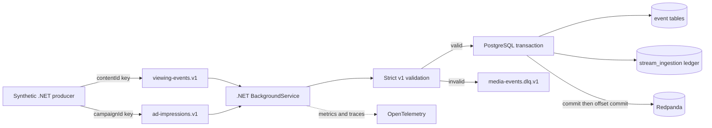

# Kafka-compatible event streaming demo

Step 18A adds an optional, local Kafka-compatible ingestion path for synthetic viewing events and ad impressions. The default Compose stack, existing APIs, analytics, agent tools, and seeded fixtures are unchanged.

## Implemented vertical slice



The implementation uses Redpanda `v26.2.4` and Confluent.Kafka `2.16.0`, both pinned. Redpanda is enabled only through `compose.streaming.yaml`; it is not part of default startup and publishes no host port.

## Topics and contracts

| Topic | Schema | Partition key | Reason |
| --- | --- | --- | --- |
| `viewing-events.v1` | `EventEnvelope<ViewingEventV1>` | `contentId` | Preserves per-title ordering while distributing titles |
| `ad-impressions.v1` | `EventEnvelope<AdImpressionV1>` | `campaignId` | Preserves campaign ordering and locality |
| `media-events.dlq.v1` | `DeadLetterEventV1` | original key | Retains source partition affinity for investigation |

Every source envelope has schema version `1.0`, a stable event UUID, UTC event time, and typed data. Unknown JSON fields, unsupported versions, mismatched IDs, non-UTC times, oversized payloads, invalid lengths, negative watch duration, empty foreign keys, and unsupported topics are rejected. The DLQ record contains source coordinates, failure code, timestamp, payload SHA-256, and the original synthetic record. DLQ values are not logged or attached to telemetry.

The checked-in contracts are in [`schemas/streaming`](../schemas/streaming).

The version is also present in the topic name. A breaking contract should use a new topic and consumer rather than changing v1 in place. A production deployment would normally add governed JSON Schema, Avro, or Protobuf compatibility checks; no schema registry is required for this demo.

## Delivery and database semantics

The consumer disables automatic offset commits. For a valid event it opens one PostgreSQL transaction, inserts the domain event and `(topic, eventId)` ingestion-ledger row, and commits. Only then does it commit the Kafka offset. A repeated event with the same hash is counted as a duplicate without inserting again. Reusing an event ID with a different payload fails validation.

Invalid records are published to the DLQ with `acks=all`; their source offset is committed only after that publish succeeds. Database/broker failures receive three bounded attempts by default. Exhaustion records a failure, seeks back to the same source offset, and waits before a new bounded cycle. This provides at-least-once consumption with durable application-level idempotency; it is not a distributed exactly-once transaction between Kafka and PostgreSQL.

The database migration adds only `stream_ingestion`, with composite primary key `(Topic, EventId)` and an index on `ProcessedAtUtc`. Existing viewing/ad tables and analytics queries remain unchanged, so streamed rows become visible through the same repository and analytics behavior.

## Run locally

```powershell
Copy-Item .env.example .env
# Set POSTGRES_PASSWORD in .env.

docker compose -f compose.yaml -f compose.streaming.yaml `
  --profile streaming up -d --build `
  postgres migrate redpanda stream-topics stream-consumer

docker compose -f compose.yaml -f compose.streaming.yaml `
  --profile streaming run --rm stream-producer
```

The topic job idempotently creates three partitions and replication factor one for each topic. Producer controls are environment variables:

| Variable | Default | Meaning |
| --- | ---: | --- |
| `STREAM_VIEWING_COUNT` | 1000 | Unique viewing events |
| `STREAM_AD_COUNT` | 500 | Unique ad impressions |
| `STREAM_RATE_PER_SECOND` | 0 | Target rate; zero means unthrottled |
| `STREAM_BURST_SIZE` | 100 | Rate-control burst size |
| `STREAM_DUPLICATE_EVERY` | 100 | Replay every nth unique record; zero disables |
| `STREAM_INCLUDE_POISON` | true | Append one malformed JSON record |
| `STREAM_PRODUCER_CONCURRENCY` | 1 | Maximum outstanding `acks=all` deliveries |
| `STREAM_PRODUCER_BATCH_SIZE` | 1 | librdkafka batch message ceiling |
| `STREAM_PRODUCER_LINGER_MS` | 0 | Bounded batching delay |
| `STREAM_PRODUCER_SEED` | 0 | Stable event-ID namespace for isolated runs |
| `STREAM_USE_CURRENT_TIME` | false | Use producer start time for freshness experiments |

The data generator is deterministic: IDs, event times, entity associations, and ordering repeat for identical counts. Re-running it is therefore an intentional duplicate-replay test.

Inspect status without exposing broker or database ports:

```powershell
docker compose -f compose.yaml -f compose.streaming.yaml `
  --profile streaming ps
docker compose -f compose.yaml -f compose.streaming.yaml `
  --profile streaming logs stream-consumer
docker compose -f compose.yaml -f compose.streaming.yaml `
  --profile streaming exec redpanda `
  rpk group describe media-intelligence-v1 -X brokers=redpanda:9092
```

Real integration test:

```powershell
docker compose -f compose.yaml -f compose.streaming.yaml `
  --profile streaming --profile streaming-test `
  run --rm streaming-tests
```

## Verified failure demonstrations

The following were performed locally on 2026-10-12 using isolated Compose volumes:

- **Consumer restart/backlog:** stop `stream-consumer`, run a 150-event producer batch with 15 duplicates, inspect group lag, then restart the consumer. Total lag moved from 165 to 0.
- **Duplicate replay:** the deterministic batch reused stable IDs. PostgreSQL retained one domain row and one ledger record per `(topic, eventId)`; duplicate offsets still committed.
- **Poison event:** one malformed record produced one `invalid_json` DLQ record. The consumer continued and committed its source offset only after DLQ acknowledgement.
- **PostgreSQL outage:** with PostgreSQL stopped, a 15-record batch left group lag at 15 after retry exhaustion. Restarting PostgreSQL allowed the same uncommitted offsets to replay and lag returned to 0.

The real Compose integration suite now passes 9 tests, including PostgreSQL/Redpanda replay safety and concurrent-producer per-key ordering.

## Measured producer throughput

The Step 18A baseline produced 1,500 unique records, 15 configured duplicates, and one poison record in 9.2039 seconds: **164.7 acknowledged records/s**. That producer awaited each `acks=all` result sequentially. Docker Desktop, Redpanda, PostgreSQL, and the consumer shared the same Windows development machine used for the project benchmarks. Step 18B measurements use the newer isolated harness and are reported separately.

This is a reproducibility observation, not a production throughput claim. It intentionally measures the simple reliability-first producer, not Kafka batching potential. Consumer throughput was not independently benchmarked; the recovery checks only establish eventual drain to zero lag.

## Telemetry and Grafana

The consumer emits bounded topic/outcome/failure-code dimensions for:

- processed throughput and processing duration;
- approximate consumer lag;
- event-time freshness;
- duplicates, DLQ records, and exhausted processing cycles.

`stream.consume` activities identify the messaging system and topic. Event bodies, stable event IDs, device IDs, credentials, and partition keys are excluded from logs, spans, and metric labels. The existing Grafana dashboard gains four streaming panels. To export them, combine the streaming and observability overrides and set `STREAMING_OBSERVABILITY=true`.

## Kafka, Redpanda, and Azure Event Hubs

- **Apache Kafka** defines the protocol and ecosystem semantics used here. The .NET code uses the standard Confluent Kafka client and does not depend on a Redpanda-specific API.
- **Redpanda** is the implemented local broker because a single pinned container provides a fast Kafka-compatible development environment. Its dev-container mode and replication factor one are explicitly not production topology.
- **Azure Event Hubs** offers a Kafka-compatible endpoint but is only a proposed deployment option. It would require TLS/SASL configuration, Azure identity/network policy, partition and retention sizing, quota evaluation, and live compatibility tests. None of those cloud resources or claims are implemented here.

Step 18B scalability methodology and local measurements are documented in [streaming-performance.md](streaming-performance.md).

Proposed next steps—not implemented—include schema-registry governance, batched database writes, partition-parallel consumers, controlled backpressure, retention policies, authentication/TLS, autoscaling, alerts, and production replay tooling.
